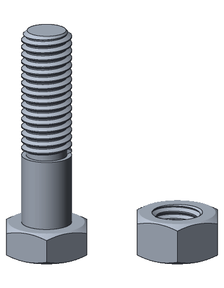
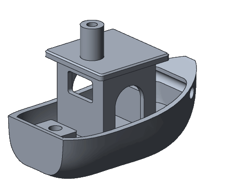
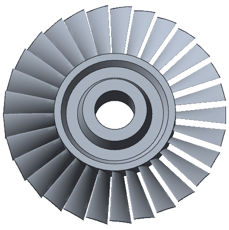

# scratchcad

> [!WARNING]
> scratchcad is under active development. APIs, tools and script syntax may
> change without notice, and things may break between commits.

scratchcad is a Rust solid modelling API built on the
[OpenCASCADE](https://dev.opencascade.org) CAD kernel, plus a local MCP server
and editor so AI assistants (and you) can use it. Parts are Rhai scripts that
build exact B-rep solids, which export to STEP, IGES, BREP, STL, OBJ and 3MF.

## Quick start (requires Docker)

Clone the [latest release](https://github.com/scratchcad/scratchcad/releases/latest)
(`main` moves fast and may be broken between releases) and start the server, the
MCP server and the editor:

<!-- x-release-please-start-version -->
```sh
git clone --branch v0.5.0 https://github.com/scratchcad/scratchcad.git
cd scratchcad
docker compose up --build        # or `docker compose watch` to reload on edits
```
<!-- x-release-please-end -->

The first build takes a few minutes. Then open the editor at
<http://localhost:8000>. To require an API token, put
`SCRATCHCAD_API_TOKEN=<16+ characters>` in a `.env` file next to `compose.yaml`.

The MCP server is already configured for this directory in `.mcp.json`. Clients
that don't read `.mcp.json` can use `http://localhost:8000/mcp` with the
streamable HTTP transport.

## Examples

Each part was modelled by Claude Code (on high effort) from the prompt beside it. The links
under the renders go to the scripts it wrote; copy one into `./output` to open it in the
editor.

| prompt | output |
|---|---|
| Create an M10 hex bolt with 26 mm thread length, a course pitch of 1.5 mm and head height 6.4 mm. Also create a matching hex nut with 8.4 mm height. Both of these should be in the same file displayed beside each other. | <br>[`m10_bolt_and_nut.rhai`](docs/examples/m10_bolt_and_nut.rhai) |
| Create a 3DBenchy. | <br>[`benchy.rhai`](docs/examples/benchy.rhai) |
| Create a mid-stage compressor blisk with these dimensions: an outer tip diameter of 440 mm, a hub platform diameter of 241.2 mm, and a radial blade span of 99.4 mm across its 29 twisted aerodynamic airfoils. Mechanically, the component is defined by an 80.0 mm shaft interface bore diameter, an axial hub length of 77.5 mm, and an airfoil rim width of 45.0 mm, with rear mounting flange diameters measuring 184 mm at the inner shoulder and 202 mm at the outer rim. Blade count of 29 twisted aerodynamic airfoils. | <br>[`blisk.rhai`](docs/examples/blisk.rhai) |

## Scripts and the editor

The agent writes a part as a Rhai script and saves it to `./output`, where the
editor picks it up:

```rhai
let width = 80.0; // [40, 120] Width (mm)
let plate = box_centered(width, 50, 6).fillet(5, "|Z");
plate - cylinder([0, 0, -5], "Z", 10, 10)
```

Each top-level `let` with a range and a label becomes a slider in the editor,
which re-meshes the part as you drag it. The editor also lists the scripts and
exports in `./output`, lets you edit the script by hand, and exports the part
as STEP, IGES, BREP, STL, OBJ or 3MF. If you edit a script and then ask the
agent for changes, it reads your version first.

The functions scripts can call are listed in the
[Rhai API reference](crates/scratchcad-occt-rhai/docs/rhai-api.md).

## Architecture

| directory | what it is |
|---|---|
| [`server/`](server) | The scratchcad HTTP service (Rust, axum). Runs Rhai scripts that build solids, then measures, renders and exports them. It is stateless and never touches your files. |
| [`mcp/`](mcp) | The MCP server and editor (TypeScript, React, three.js). Gives a model tools to write, view, measure, save and export a part, and gives you a live 3D preview with sliders. It runs on your machine and is the only part that reads and writes files. |
| [`crates/`](crates) | The Rust crates that script OpenCASCADE: [`scratchcad-occt-rhai`](crates/scratchcad-occt-rhai), the Rhai API, and [`scratchcad-occt-sys`](crates/scratchcad-occt-sys), the C++ bindings under it. Also published on crates.io. |

The MCP server reaches scratchcad at `SCRATCHCAD_URL`, so it works with a local
build, the dev container or a deployed instance; the editor only talks to the
MCP server, so an API token never reaches the browser. See
[`server/README.md`](server/README.md) and [`mcp/README.md`](mcp/README.md) for
running each on its own, and `docker compose run --rm mcp npm test` for the MCP
server's checks.

## Contributing

Contributions are welcome. See [CONTRIBUTING.md](CONTRIBUTING.md); every commit
needs a DCO sign-off (`git commit -s`). Report security vulnerabilities
privately as described in [SECURITY.md](SECURITY.md), not in public issues.

## License

scratchcad is licensed under the [Apache License 2.0](LICENSE), except for the crates in
[`crates/`](crates), which are licensed under the
[LGPL 2.1 only](crates/scratchcad-occt-sys/LICENSE): each has its own `LICENSE` and `NOTICE`.
Its dependencies are listed with their licenses in
[`THIRD_PARTY_NOTICES.txt`](THIRD_PARTY_NOTICES.txt).

scratchcad makes use of [Open CASCADE Technology](https://dev.opencascade.org), which is
licensed under the LGPL 2.1 with the Open CASCADE exception, through those crates. Until
2026-10-18 they were developed in
[scratchcad-occt-rs](https://github.com/scratchcad/scratchcad-occt-rs), whose history has their
earlier changes.

## If you've found scratchcad useful please leave a star


